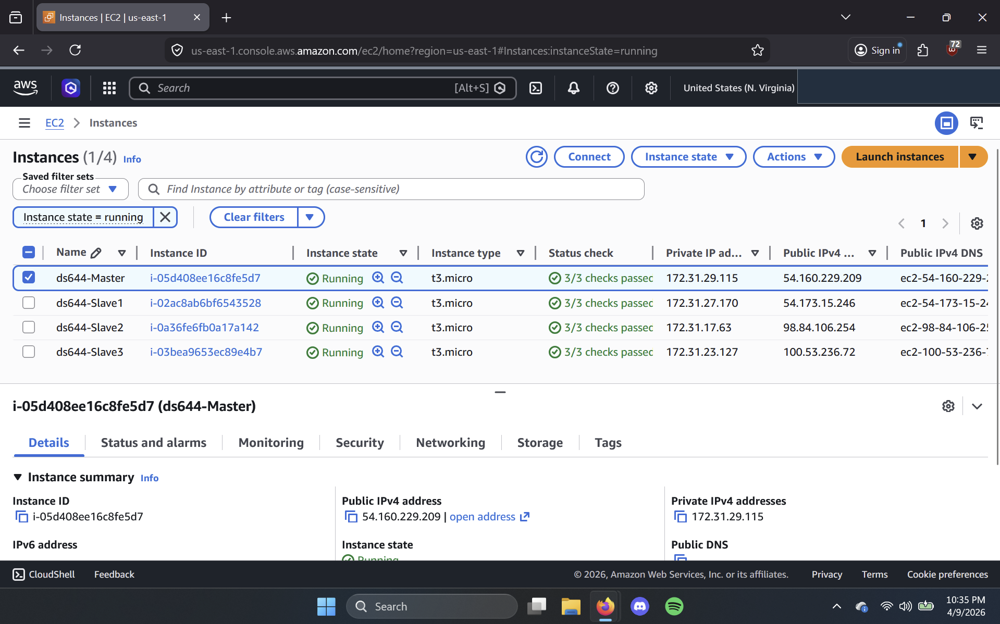
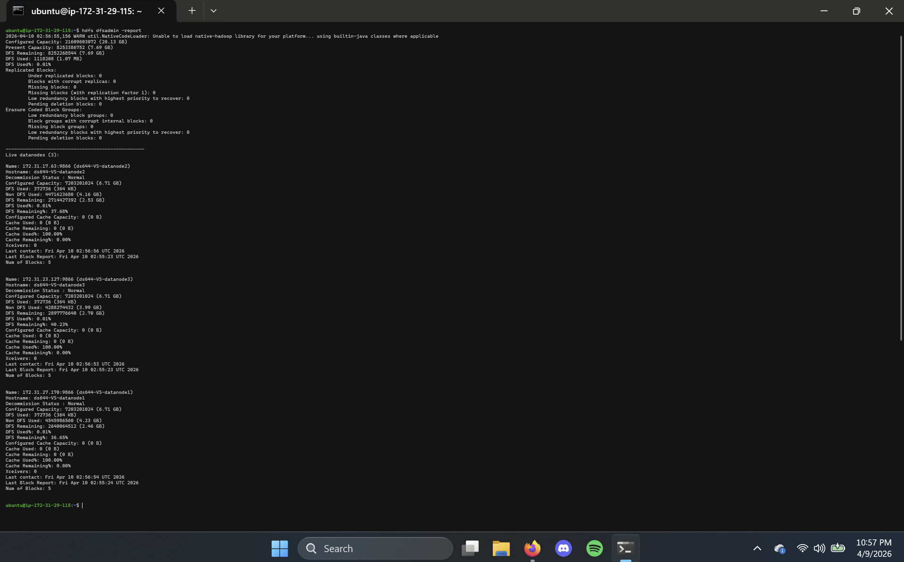
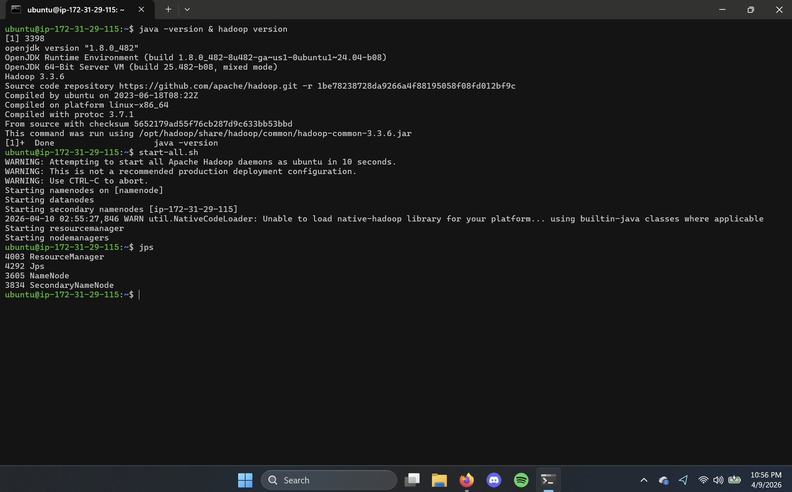
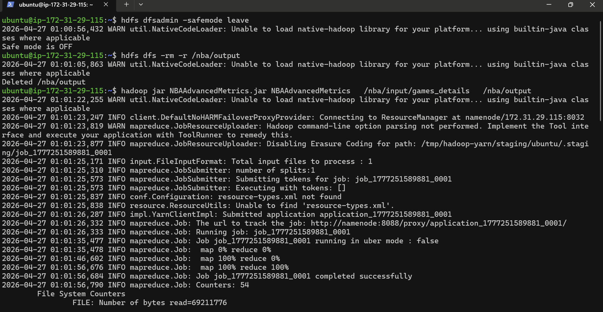
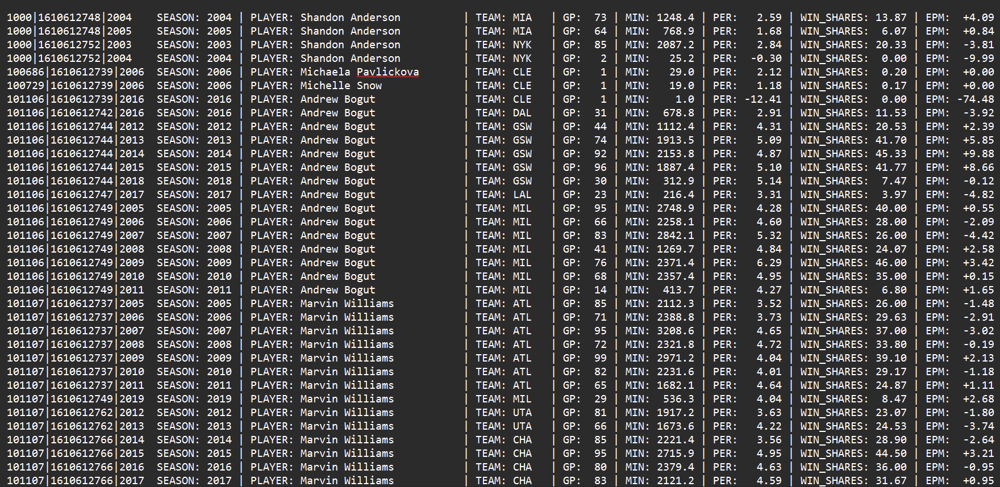

# NBA Advanced Metrics — Hadoop MapReduce

Computes custom Player Efficiency Rating (PER), Win Shares, and Estimated Plus/Minus (EPM) for every NBA player-team-season combination, by running a from-scratch Hadoop MapReduce job over ~668,000 real box-score rows on a self-managed 4-node AWS cluster.

## Overview

Raw box-score data — one row per player per game — doesn't answer "how good was this player in a season?" on its own. This project aggregates that raw data into per-season advanced metrics using MapReduce: a `Mapper` parses each box-score line into a per-player-team-season key, and a `Reducer` aggregates all of a player's games for that team and season into three custom advanced stats, computed from scratch (not calls to any stats API or library).

The whole pipeline runs on a real, self-provisioned 4-node Hadoop cluster on AWS EC2 — not a local single-node setup — which is where most of the actual engineering challenges in this project came from (see [Challenges](#challenges) below).

## Key features

- Custom MapReduce job computing three advanced basketball metrics from raw per-game stats
- Composite key design (`PLAYER_ID|TEAM_ID|SEASON`) so trades and multi-season careers aggregate correctly
- Reference data (team names, season win totals) distributed to every node via Hadoop's `DistributedCache`, avoiding a fragile shuffle-based join
- Deployed and run on a real 4-node Hadoop cluster (1 master + 3 slaves) on AWS EC2, not a local simulation
- Processed 668,629 real input records into 12,742 player-season results in one job run

## Demo

**AWS EC2 cluster — 4 nodes running the Hadoop cluster:**



**Cluster startup — Hadoop/Java versions and running daemons:**



**HDFS health check — all 3 DataNodes live:**



**Job execution — compiling, submitting, and completion:**



**Sample output — real computed metrics:**



## Architecture

```
games_details.csv → [Mapper: parse box score → key=PLAYER_ID|TEAM_ID|SEASON] 
                  → shuffle/sort by key
                  → [Reducer: aggregate season, compute PER / Win Shares / EPM]
                  → nba_results.txt
```

`teams.csv` and `ranking.csv` are loaded into every reducer via `DistributedCache` rather than joined through the shuffle. Full design rationale, the exact metric formulas, and a walkthrough of three real production issues (and their fixes) are in [`docs/architecture.md`](docs/architecture.md).

## Tech stack

- **Java** — the MapReduce job itself (`Mapper`, `Reducer`, `DistributedCache`)
- **Apache Hadoop 3.3.6** (HDFS + YARN + MapReduce)
- **AWS EC2** — 4-node self-managed cluster (1 Master + 3 Slaves, `t3.medium`)
- **OpenJDK 1.8**

## Getting started

### Prerequisites

- A Hadoop cluster (this was run on a 4-node EC2 cluster; a local single-node Hadoop install also works for smaller test runs)
- Java 8 (OpenJDK 1.8+)
- The dataset (see [Data](#data) below)

### Compile and package

```bash
export HADOOP_CLASSPATH=$(hadoop classpath)
javac -classpath $HADOOP_CLASSPATH -d . src/NBAAdvancedMetrics.java
jar -cvf NBAAdvancedMetrics.jar *.class
```

### Upload input data to HDFS

```bash
hdfs dfs -mkdir -p /nba/input
hdfs dfs -put data/teams.csv data/ranking.csv data/games_details.csv /nba/input/
```

### Run the job

```bash
hdfs dfsadmin -safemode leave
hdfs dfs -rm -r /nba/output
hadoop jar NBAAdvancedMetrics.jar NBAAdvancedMetrics /nba/input/games_details /nba/output
```

### Retrieve results

```bash
hdfs dfs -getmerge /nba/output output/nba_results.txt
```

A real output file from this exact pipeline is already included at [`output/nba_results.txt`](output/nba_results.txt) (12,742 player-season rows), so you can see the actual results without re-running the job.

## Project structure

```
nba-advanced-metrics-mapreduce/
├── src/
│   └── NBAAdvancedMetrics.java
├── data/
│   └── teams.csv
├── output/
│   └── nba_results.txt
├── docs/
│   ├── architecture.md
│   └── images/
├── original-submission/
│   └── BigData_Option1_Shah_Vivek.pdf
├── LICENSE
└── README.md
```

## Data

Source: [nathanlauga/nba-games on Kaggle](https://www.kaggle.com/datasets/nathanlauga/nba-games) — public NBA game data, no personal or sensitive data.

- `data/teams.csv` — team ID → abbreviation lookup (included; small)
- `data/games_details.csv` (93 MB, ~668k rows) and `data/ranking.csv` (15 MB) are **not committed** — too large for a git repo. Download them from the Kaggle link above and place them at those paths to reproduce the run.
- `players.csv` and `games.csv` from the original dataset were part of the initial data exploration but aren't used by the final MapReduce job — player names are read directly from `games_details.csv`.

## Testing

There's no automated test suite here — correctness was verified by cross-checking the job's own Hadoop counters (map input/output records, reduce output records) against the row counts in the output file, and spot-checking individual player rows for plausibility. See the [job output stats table](docs/architecture.md#job-output-stats-real-run) in the architecture doc for the exact counters.

## Results

- **668,629** map input records → **558,746** map output records → **12,742** unique player-team-season results
- Full run completed successfully on the 4-node cluster after resolving the issues below

## Challenges

Three real problems came up building and running this on an actual multi-node cluster (not a toy example) — node instability from undersized EC2 instances, a broken join from inconsistent team IDs, and a Hadoop shuffle-ordering assumption that silently produced empty output. Each is explained with its root cause and fix in [`docs/architecture.md`](docs/architecture.md#challenges-and-fixes).

## Roadmap

- Replace the hand-picked PER weights with the NBA's actual published formula
- Implement Win Shares using the real offensive/defensive split methodology
- Derive EPM from a proper regression model instead of a fixed per-minute scaling
- Add a `Combiner` to cut shuffle volume
- Port the job to Apache Spark

## My role

I built this individually (solo, no partner) for the final term project of DS644 (Introduction to Big Data). I designed and implemented the Mapper/Reducer logic, the composite key scheme, the DistributedCache-based lookup approach, and all three metric formulas from scratch, and provisioned and debugged the 4-node AWS Hadoop cluster myself.

## License and contact

Licensed under the [MIT License](LICENSE).

**Contact:** [github.com/VS-2K01](https://github.com/VS-2K01)
